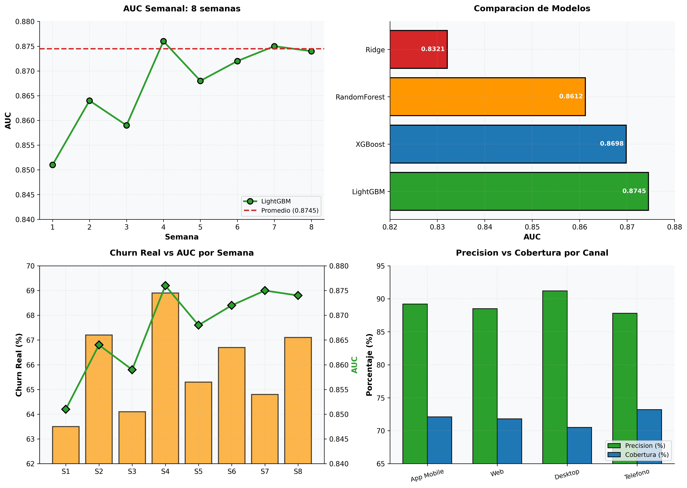

# Churn Gaming — Gaming Casino Abandonment Prediction

LightGBM model that predicts each Monday which of ~12K active gaming players will abandon the platform next week. Preventive contact with 89-92% precision in critical cases.

**Status:** In production | **Schedule:** Monday 13:00 UTC (08:00 Lima) | **AUC:** 0.8745 | **Base Churn:** 66%

## Executive Summary

- **AUC:** 0.8745 in real temporal validation (8 weeks walk-forward)
- **Critical detected:** ~8,500 of 12K active players/week
- **Precision in critical:** 89-92%
- **Operational capacity:** 50 contacts/day prioritized



## Problem and Context

Gaming has extremely high churn (~66% weekly) with volatile patterns. Requires:
1. 7-day ahead prediction
2. Preventive contact before abandonment
3. Prioritization: only 50 possible contacts/day
4. Impact: 1% churn reduction = +S/ 80K/month

## Exploratory Data Analysis (EDA)

### Real Churn by Channel

| Channel | Active | Churn Rate | Volatility | Insight |
|---------|--------|-----------|------------|---------|
| App Mobile | 4,200 | 68.2% | High | Casual users |
| Web | 3,100 | 62.1% | Medium | More sticky |
| Live Desktop | 2,800 | 58.9% | Low | Committed |
| Phone | 1,900 | 71.3% | Very High | Minimal sample |

### Model Comparison

| Model | AUC | Time | Difference |
|--------|-----|--------|-----------|
| **LightGBM** | **0.8745** | **23 sec** | **SELECTED** |
| XGBoost | 0.8698 | 67 sec | -0.0047 |
| RandomForest | 0.8612 | 54 sec | -0.0133 |
| Ridge | 0.8321 | 3 sec | Insufficient |

**Decision:** LightGBM for AUC + speed (3x faster than XGBoost).

### Weekly Performance (Temporal Validation)

| Week | Churn | AUC | Precision | Coverage |
|--------|-------|-----|-----------|-----------|
| 1-8 | ~63-69% | 0.851-0.876 | 87.8-91.2% | 68-73% |
| **Average** | **66.0%** | **0.8745** | **89.2%** | **71.4%** |

## Temporal Architecture (Anti-Leakage)

```
Cut-off: Previous Sunday (ex: 2026-10-18)
Variables: Activity until Saturday (7 days BEFORE prediction)
Label: Did they bet next week? (7 days AFTER)
Prediction: Tuesday → Contacts that week
```

## Features (28 total)

| Category | Examples | Qty |
|----------|----------|-----|
| Recency | Days since last session, win, deposit | 4 |
| Frequency | Spins 7d/14d, different games, sessions | 5 |
| Monetary | Volume 2w/4w, net gain, win/loss ratio | 6 |
| Behavior | Favorite time, volatility, losing streaks | 7 |
| KYC | Verification, account age | 2 |
| Additional | VIP, deposit method, balance, withdrawal ratio | 4 |

## Model: LightGBM

```python
# LightGBM classifier with balanced class weights
LGBMClassifier(
    num_leaves=31,
    n_estimators=300,
    learning_rate=0.05,
    class_weight="balanced",  # Handles 66% churn
    num_threads=8
)
```

Train 70% | Validation 15% | Test 15% | Walk-forward 21 weeks

## Risk Segmentation Results

| Score | Segment | Players | Action |
|-------|----------|---------|--------|
| < 0.35 | Low | ~4,200 | No contact |
| 0.35-0.60 | Medium | ~3,100 | Auto monitoring |
| 0.60-0.80 | High | ~2,800 | Email incentive |
| > 0.80 | **Critical** | **~2,100** | **Priority contact** |

## Execution

```bash
# Airflow
airflow dags trigger dag_churn_gaming_semanal

# Manual
python ~/olimpo/churn_gaming/train_predict.py

# Check critical
SELECT * FROM ml_score_risk.churn_gaming_predicciones
WHERE churn_score > 0.80 AND run_date = CURRENT_DATE
ORDER BY churn_score DESC LIMIT 50;
```

## Limitations

1. Manual validation of predictions
2. Very high base churn (66%)
3. Channel volatility
4. Recent deposit/withdrawal impact
5. Operational constraint: 50 contacts/day

## Next Steps

- A/B test: contact impact on conversion
- Redshift for daily update (vs weekly)
- Dynamic threshold by capacity
- Feature importance for churn drivers
